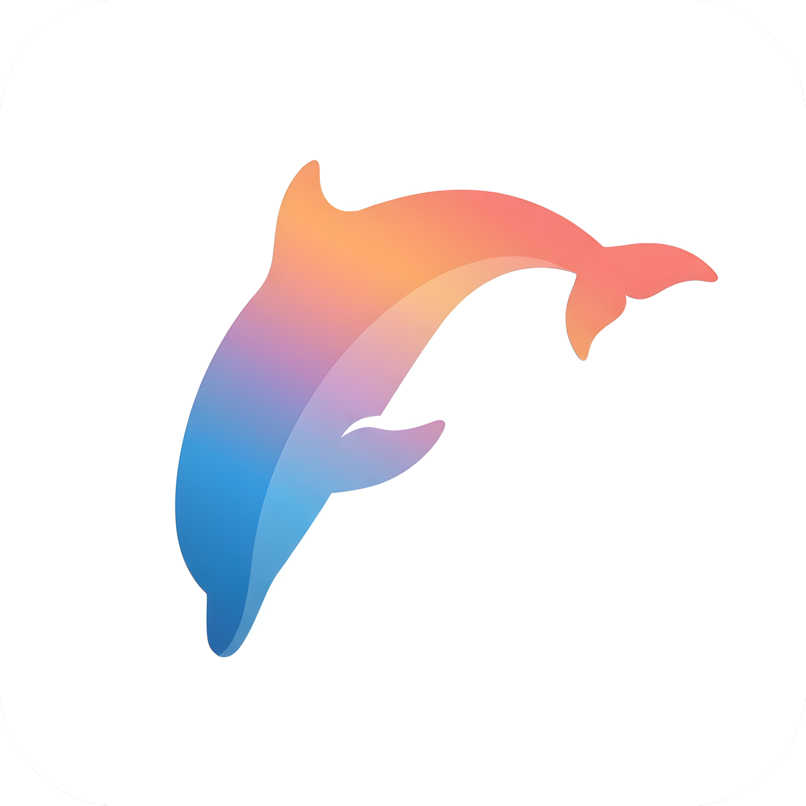

<p align="center">
  
</p>

<h1 align="center">Dolphin Pod</h1>
<p align="center">Your pod of AI agents, in one chat.</p>

Dolphin Pod is a modern, light & fast group chat-like app where the members are AI agents. Roger moderates, Lincoln orchestrates,
and a team of specialists (coding, long-horizon projects, security, debugging, writing, docs, images and
teaching, fun facts, verification, web research and git) answer in shared chats. Every agent runs on the local or cloud reasoning model you choose.

## Highlights

- **Chats with a crew**: Coding, General, Long Horizon Agentic, Learning and Creative out of the box, plus your own.
- **Routing that thinks**: Roger acknowledges instantly, decides intent and mode (learn, quick, plan, implement),
  Lincoln briefs the right specialist, and `@mentions` go straight to an agent.
- **Plans before power**: planning runs read-only; approving a plan (button or "approve") grants full
  agentic permissions inside a workspace folder. Every action is logged.
- **Any provider**: Ollama, LM Studio, custom OpenAI-compatible servers, OpenRouter, OpenAI, Anthropic,
  Google Gemini, xAI, Mistral, DeepSeek, Groq, Together, Fireworks and Azure OpenAI. Only reasoning models
  are selectable, and the effort control adapts to each model.
- **Streamed thinking** from every provider, full Markdown with code highlighting and math.
- **Smart context handling**: conversations are compacted automatically before they fill a model's context window
  (older messages become a saved summary, never silently dropped), large tool output (logs, files, search hits,
  JSON) is compressed by content type with the full text one tool call away, and prompts are laid out for provider
  prompt caching. Only the relevant parts of your custom instructions are sent.
- **Sync and iPhone**: optional end-to-end encrypted sync (Postgres/NeonDB, your passphrase, a recovery key) keeps
  chats, agents, settings and provider keys identical across desktops and the iPhone app, and the iPhone can start
  work on a desktop, nearby over Wi-Fi or through the cloud.
- **Housekeeping**: rolling 24-hour cleanup per chat, automations at a time of day, and Roger can change any
  setting from chat.
- **Frosted glass UI** in dark and light, personalizable agent colors and gradients, hover cards with all-time
  usage and timing.

## Development

Requirements: Rust (stable), Node 22+, pnpm 10, and the [Tauri prerequisites](https://tauri.app/start/prerequisites/).

```bash
pnpm install
```

```bash
pnpm dev
```

`pnpm dev` starts the desktop app with hot reload. To work on the UI in a plain browser (with a mock backend), run
`pnpm --filter @dolphin/desktop dev` and open http://localhost:1420.

| Task                          | Command                                                         |
| ----------------------------- | --------------------------------------------------------------- |
| Core tests                    | `cargo test -p dolphin-core`                                    |
| Frontend tests                | `pnpm --filter @dolphin/desktop test`                           |
| Regenerate TS types from Rust | `pnpm bindings`                                                 |
| Regenerate all icons          | `python3 packages/brand/scripts/make_icons.py`                  |
| Live run against Ollama       | `cargo run -p dolphin-core --example live_ollama -- qwen3.5:2b` |
| Release build                 | `pnpm --filter @dolphin/desktop tauri build`                    |
| iOS framework and app         | see [apps/ios](apps/ios/README.md)                              |
| Website dev server            | `pnpm --filter @dolphin/website dev`                            |
| Website production build      | `pnpm --filter @dolphin/website build`                          |

Data lives in the OS app-data folder (`dolphin-pod.db`, SQLite). API keys are stored in the system keychain.

## Credits

Built by **[MintFlow Technologies](https://mintflow.dev)**.
Lead developer: **Luca Montanari** ([@montanarii.luca](https://instagram.com/montanarii.luca)).

© 2026 MintFlow Technologies. All rights reserved. See [LICENSE](LICENSE).
